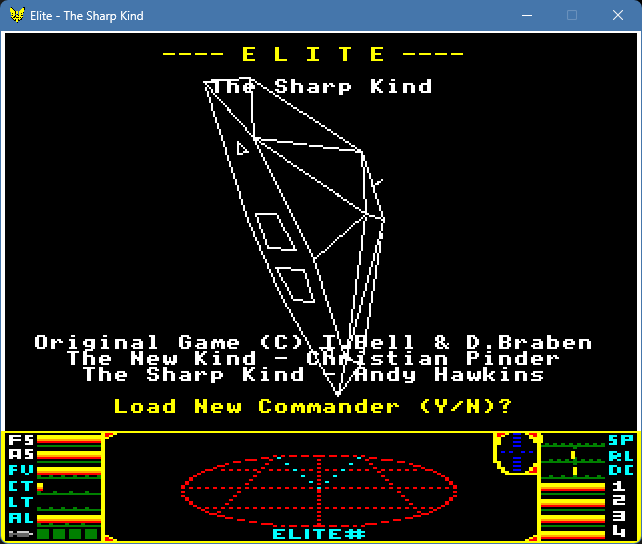
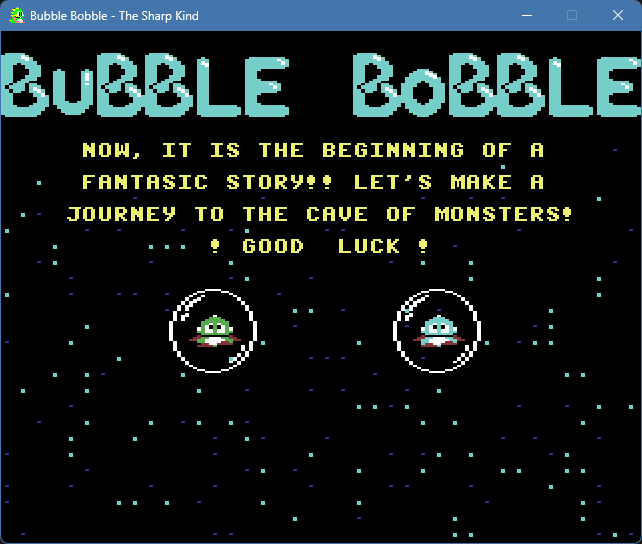
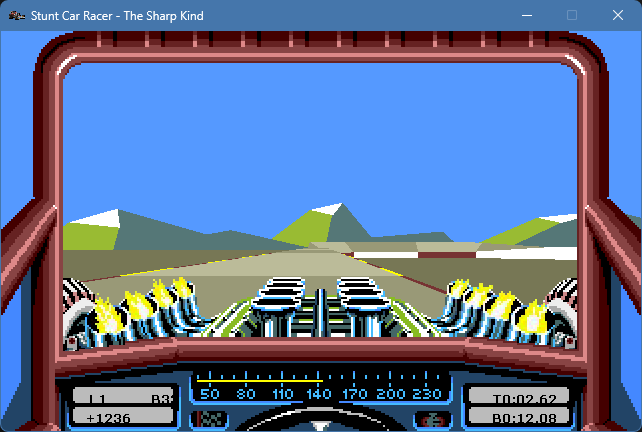

# The Sharp Kind

[](https://github.com/aphawkins/the-sharp-kind/actions/workflows/build-and-package.yml)

[](https://github.com/aphawkins/the-sharp-kind/releases/latest)
[](LICENSE)

Classic 8/16-bit computer games re-engineered in C# / .NET to look, feel and play like the originals while running cross-platform on modern systems.

A games engine built like a business application, that nobody asked for, but might be just what you need!

* Choose your era of game front end (8-bit, 16-bit, or Modern)
* Choose your graphics rendering style (wireframe, solid, shaded)
* Authentic sound and music (C64 SID, MIDI, WAVE)
* Keyboard, Controller, and Joystick support (analog and digital)

> [!IMPORTANT]
> **How you can help**
>
> - Are you a talented 2D or 3D artist, musician, or sound designer?
> - Do you have experience of 2D or 3D game development, or C#/.NET programming?
>
> Reach out via [GitHub Discussions](https://github.com/aphawkins/the-sharp-kind/discussions).

[Project site](https://aphawkins.github.io/the-sharp-kind/)

## Games

### [Elite - The Sharp Kind](docs/elite-readme.md)



Status: Playable, feature-complete - 8-bit and 16-bit versions

### [Bubble Bobble - The Sharp Kind](docs/bb-readme.md)



Status: Playable, feature-complete - 8-bit version

### [Stunt Car Racer - The Sharp Kind](docs/scr-readme.md)



Status: Playable, preview.

## Getting started

Requires the [.NET SDK](https://dotnet.microsoft.com/download) (see `Directory.Build.props` for the target framework version).

```bash
# Elite
dotnet run --project src/elite/apps/EliteSharp

# Bubble Bobble
dotnet run --project src/bb/apps/BubbleBobbleSharp

# Stunt Car Racer
dotnet run --project src/scr/apps/StuntCarRacerSharp

# Control gallery - every shared UI control, for looking at
dotnet run --project src/useful/apps/SharpKind.UI.Gallery
```

All three games can also be run and debugged from an IDE:

- **Visual Studio 2026** - open [TheSharpKind.slnx](TheSharpKind.slnx) and set `EliteSharp`, `BubbleBobbleSharp` or `StuntCarRacerSharp` as the startup project.
- **VS Code** - open the repo root and pick the "Elite", "Bubble Bobble" or "Stunt Car Racer" launch configuration (`.vscode/launch.json`).

SDL3 and its native libraries come inside their NuGet packages (win-x64, linux-x64 and linux-arm64), so there is nothing else to install: `dotnet run` or `dotnet build` is enough.

Tested platforms: Windows (x64), Ubuntu (x64), Raspberry Pi 4 (ARM64).

### Pick your era

A rendition isn't a skin: it's a whole machine's worth of personality. Pick **8-bit** for chunky pixels, sixteen colours and a SID chip singing its heart out. Pick **16-bit** for 4,096 colours, smooth shading and a SoundFont orchestra. **Modern** is on its way, and it throws the limits away.

| | `8-bit` | `16-bit` | `Modern` (work in progress) |
| --- | --- | --- | --- |
| Render resolution (Elite) | 320 x 256 | 640 x 512 | 1280 x 720 |
| Render resolution (Bubble Bobble) | 320 x 200 | - | - |
| Colours | 16 | 4,096 | 16.7 million |
| Fonts  | 8 x 8 bitmap glyphs <br /> 40 columns x 32 rows | 32 x 32 Bitmap glyphs | TrueType or Bitmaps |
| Sound | C64 SID emulation | MIDI & SoundFont | WAV, MIDI, SID |
| Window scaling | 1, 2 or 4 | 1 or 2 | 1 |

## Configuration

Each game keeps its settings in a JSON file in the shared per-user data directory (`%AppData%\The Sharp Kind` on Windows, `~/.config/The Sharp Kind` on Linux/macOS): `elite.sharp`, `bubblebobble.sharp` and `stuntcarracer.sharp`. Saves and logs live in the same place. The file is written with defaults on first run, and if it is missing or invalid the game falls back to defaults rather than refusing to start.

``` json
{
    "version": 1,                              // Schema version, so a later change to the file's shape can be migrated rather than reset.  Written automatically
    "engine": {
        "backend": "Software",                 // Which backend runs the game.  Software (CPU rasteriser blitted through SDL) or Hardware (SDL-accelerated).  It picks the mixer as well as the rasteriser, so it isn't graphics-only
        "activeController": "",                // Elite only.  Which joystick or gamepad flies the ship, by the name its driver reports.  Empty means the first one plugged in.  The keyboard always works
        "graphics": {
            "fps": 60,                         // Maximum render frame rate, up to 1000.  The game speed is independent of it
            "fillMode": "Solid",               // How a primitive becomes pixels - every object together, so it can't end up half one and half the other.  Wireframe or Solid
            "depthSort": "ZBuffer",            // Depth-sort strategy for filled rendering (ignored when fillMode is Wireframe).  Painter or ZBuffer
            "shading": "Unlit",                // What colour a face takes (ignored when fillMode is Wireframe, or in a rendition that does not shade).  Unlit (the model's flat colour), Lambert (one tone per face, from the angle it faces the light) or Gouraud (the tone blended across the face, from its corners)
            "quantisation": "Nearest",         // How a shaded colour is reduced to one the rendition can show.  Nearest, or Ordered to dither between the two either side of it
            "fontKind": "Bitmap",              // Which kind of font text is drawn with.  Bitmap (the rendition's own sheets), Fon (a Windows .fon) or TrueType.  A rendition declaring no font of the chosen kind draws with its own sheets
            "showFps": false                   // Elite only.  Overlay the measured frame rate.  A diagnostic, so off by default
        },
        "sound": {
            "effects": true,                   // Play sound effects
            "music": true                      // Play music
        },
        "logging": {
            "minimumLevel": "Information",     // Lowest level written to the log file and console.  Trace, Debug, Information, Warning, Error, Critical or None.  The ELITE_LOG_LEVEL, BB_LOG_LEVEL and SCR_LOG_LEVEL environment variables override it, for when the config file itself is what needs debugging
            "retainedFileCount": 7             // How many rolling daily log files are kept, 1 to 366, before the oldest are deleted
        },
        "rendition": "8-bit",                  // Which rendition the game draws itself as: "8-bit", "16-bit" or "Modern", if the game ships it (see below).  A rendition brings its own artwork, fonts, palette, models and sound, and its own resolution.  Elite and Bubble Bobble default to 8-bit, Stunt Car Racer to 16-bit
        "windowScale": 4,                      // How many window pixels each rendered pixel occupies, 1 to 4.  The game still renders at the rendition's own resolution and is magnified at presentation, so scale 2 is a window twice the size with the same pixels doubled, not more detail.  Which scales are on offer is the rendition's own (see below); omit it and the rendition's default is used
        "fieldOfView": null                    // Elite only.  The vertical field of view in degrees, 30 to 120.  Omit it, or null, for the original's own projection
    }
}
```

### Environment variables

Diagnostic opt-ins read at runtime rather than compiled in, so they work in a Release build. These are the ones every game shares; each game's own are in its readme ([Elite](docs/elite-readme.md#environment-variables), [Stunt Car Racer](docs/scr-readme.md#environment-variables)).

| Variable | Value | Effect |
| -------- | ----- | ------ |
| `GAME_KEY_SCRIPT` | A path to a script file, or the script text itself if the value isn't an existing file | The script is replayed into the keyboard tick by tick, for reproducible input without OS-level key injection |
| `GAME_FRAME_DUMP_DIR` | A directory path, created if it doesn't exist | Framebuffer BMPs are written there, and the F12 dump key is enabled |

## Tools

### [SharpKind.Cryptography](src/useful/apps/SharpKind.Cryptography.PowerShell/README.md)

A PowerShell 7.6+ module that encrypts, decrypts and cracks classical ciphers, from Caesar to Enigma.

```powershell
Install-PSResource SharpKind.Cryptography
'Attack at dawn' | Protect-CipherText -Cipher Caesar -Settings @{ RightShift = 3 }
```

## Documentation

- [Elite - The Sharp Kind](docs/elite-readme.md)
- [Bubble Bobble - The Sharp Kind](docs/bb-readme.md)
- [Stunt Car Racer - The Sharp Kind](docs/scr-readme.md)
- [Architecture principles](docs/architecture-principles.md)
- [Backlog](docs/backlog-roadmap.md) - every open work item, bugs first
- [Changelog](CHANGELOG.md)
- [Release notes](docs/release-notes.md) - a concise, categorised summary of the changelog, split at v1.0.0
- [Release process](docs/release-process.md) - how to cut a tagged release
- [Contributing](CONTRIBUTING.md)

## Licence

[MIT](LICENSE). Original game copyrights remain with their respective owners - see each game's readme for credits.
