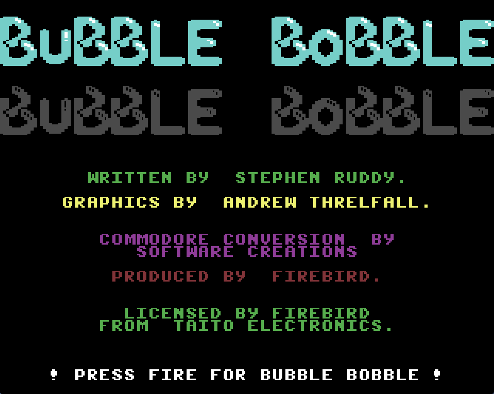

# The Sharp Kind

Classic 8/16-bit computer games re-engineered in C# / .NET, sharing a common set of `SharpKind.*` game-engine libraries. The games are meant to look, feel and play like the originals while running cross-platform on modern hardware.

Source on GitHub: [aphawkins/the-sharp-kind](https://github.com/aphawkins/the-sharp-kind).

## Games

### [Elite - The Sharp Kind](elite-readme.md)

Status: Playable, feature-complete.

A C# port of the classic BBC home computer game 'Elite', aiming for authenticity, object-oriented code and cross-platform compatibility.

### [Stunt Car Racer - The Sharp Kind](scr-readme.md)

Status: Playable, preview.

A C# port of Geoff Crammond's 'Stunt Car Racer', converted from the C++/DirectX9 Windows remake of the Amiga original.

### [Bubble Bobble - The Sharp Kind](bb-readme.md)

Status: Work in progress.

A C# port of the C64 'Bubble Bobble', converted from a byte-exact disassembly of Software Creations' 1987 conversion.

## SharpKind libraries

All three games are built on a shared set of engine libraries under `src/useful/` — graphics, audio, input, assets and the game loop — published as `SharpKind.*` NuGet packages.

## Learn more

- [Project README](https://github.com/aphawkins/the-sharp-kind#readme)
- [Architecture principles](architecture-principles.md)
- [Changelog](https://github.com/aphawkins/the-sharp-kind/blob/main/CHANGELOG.md)
- [Release notes](release-notes.md) — a concise, categorised summary of the changelog, split at v1.0.0
